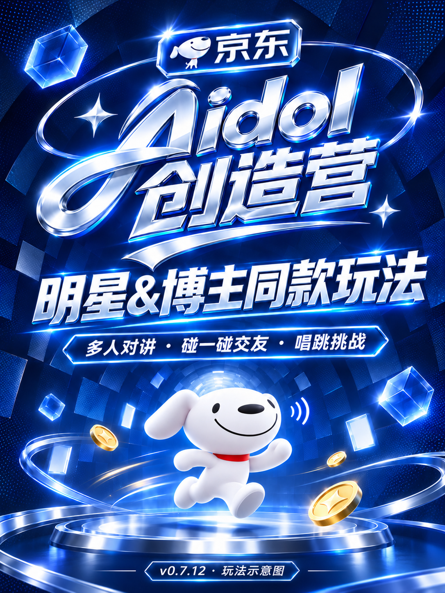

# 京东 Aidol 创造营 · 碰友对讲

明星&博主同款玩法：多人对讲、碰一碰交友、JOY 唱跳挑战。



固件 **v0.7.12**，配套蓝牙助手 **v0.3.7**。封面为 AI 生成的玩法示意图。

同伴可以离线组队，对全体或指定队友按住说话；靠近并双方确认后交换名片。唱跳挑战用声音控制 JOY：发声前进、升调跳高、停声换气，到终点后比较房间成绩。

## 下载与上手

在 [Releases](https://github.com/arraylee/ai-passport-aidol-camp/releases/tag/v0.7.12) 下载完整网页刷机 BIN、分段固件包和蓝牙助手。社区页面提供同一份 BIN。

- [中文快速上手](docs/QUICKSTART.zh.md)
- [English quick start](docs/QUICKSTART.en.md)
- [蓝牙助手说明](tools/device_console/README.md)：Mac 扫描多台设备，分别选择人物，设置并重置或独立清空数据；完成后自动断开连接，无需 USB 和重启。

官网刷机时选 `AI-PASSPORT-BLE-Config-v0.7.12-web.bin`，起始地址 **0x0**，不要全片擦除。网页合并 BIN 保留原 SN 身份区，但会覆盖普通 NVS；需保留普通 NVS 时使用分段包和 `tools/safe_flash.py`。分段应用 BIN 的地址为 **0x10000**。

完整网页 BIN SHA-256：

```text
5074de9d14063d03305c8f41ca999b75f6a8dd383e7ba7ea96a8df63aacd1276
```

## 版本与预设

v0.7.12 修正首次激活后仍进入旧组网编号页的问题：自动保存默认人物并直接进入首页；手动入口改为“人物资料”。蓝牙连接期间暂停激活键，避免打断配置回读。详见 [首次启动修正](docs/FIRST-BOOT.md)。

v0.7.11 将首页昵称区调整到 108px，减少短昵称滚动；其他超长名字保留原滚动规则。包含 v0.7.10 的好友页主动寻找，以及此前的对讲恢复、游戏结算和排行榜修复。

新机默认使用内置喵喵头像、昵称和签名。用户通过蓝牙或小程序设置的资料存放在设备数据区；升级会保留已有资料。蓝牙助手的可选预设不会自动应用，只有明确选择并执行才会更换人物。

## 构建与测试

使用 ESP-IDF **5.5.3**。依赖按 `dependencies.lock` 安装，不需要云服务密钥。

```sh
. /path/to/esp-idf-v5.5.3/export.sh
idf.py build size
python3 -m pip install Pillow
cmake -S tests -B build-host
cmake --build build-host -j6
ctest --test-dir build-host --output-on-failure
python3 tests/test_release.py
python3 tests/test_safe_flash.py
python3 tools/package_ble_release.py
python3 tools/verify_release.py releases/v0.7.12
```

蓝牙助手：

```sh
python3 -m venv .venv
.venv/bin/pip install -r tools/device_console/requirements.txt
.venv/bin/python -m unittest discover -s tools/device_console/tests
```

## 验证范围

本版 v0.7.12 包含首次启动与蓝牙激活保护修正，固件与旧版不同。发布包包含构建、42项宿主测试、哈希和写入地址证据；实际设备检查独立记录。

单机已验证首次激活直接进入首页、基本按键和声控、资料重启保留、蓝牙设置及清空后保留人物，并恢复内置默认喵喵。实际空闲1200秒后开始告别，约1.7秒后完成关屏、关闭外设并进入深睡流程，USB随后离线。用户确认黑屏后可用上键正常唤醒，默认喵喵仍在。测试机后来被其他任务接管，底层唤醒原因和最终保护区复核未采集。详见 [本版实机记录](docs/DEVICE-VALIDATION-v0.7.12.md)。

本轮只有一台设备；双机对讲、好友互传、多人排行榜、完整通关与成绩保存、满充续航均未验收。游戏、通话、蓝牙管理或待处理工作会推迟20分钟空闲休眠。不提供未经实测的续航承诺。

## 源码与素材

原创程序代码使用 [MIT License](LICENSE)。字体、第三方代码、人物照片、JOY、京东/Aidol 标识、活动 KV 与音频分别保留原权利和许可，不属于 MIT 授权，见 [素材说明](THIRD_PARTY_NOTICES.md)。

[开发历史与技术说明](docs/DEVELOPMENT-HISTORY.md) · [手动加好友](docs/MANUAL-FRIENDS.md) · [蓝牙接口](docs/BLE-CONSOLE.md)
